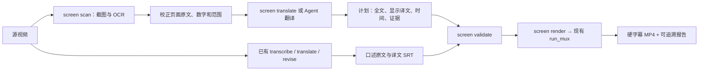

# 画面文字翻译与硬字幕流程

## 目标与实现边界

产品演示中的页面文字和音轨讲话分别提取、翻译，再合成有来源的统一时间轴，输出中文硬字幕视频。
原片只读，默认不改变时长，音乐和讲话原声保留。Claude Duet 的99秒视频是本流程的实际来源：
前一分钟主要是界面文字，后半分钟有人声；单独转写音轨既漏页面，也可能在配乐处产生幻觉。

新增入口是 `video-txt screen`。复用 `translate_subtitle_file`、字幕类型和 `run_mux`，
不建立第二套模型客户端、Whisper 调用器或编码器。现有 `run / dub / project` 行为不变；
本次新增独立 `screen-plan` v1，尚不接入 `project run` 的阶段调度。



## 各阶段的职责

1. **采样**：默认每秒一张，记录每次 seek 的绝对秒数。快速滚动或数字变化可局部加密。
   默认上限600张，超限报错；不默默截断。不承诺自动发现取样间隔内闪过的所有文字。
2. **候选合并**：相邻相似画面合并，保留全部文本版本和截图。数字归一化只用于分组，原文不改、
   不取平均数。默认建议用组内最后一个 OCR 样本，但保持 draft，必须查看原图。
3. **翻译**：先校正 OCR；使用现有提供商、术语表、重试及译文检查。默认本机 LM Studio；
   不自动上传截图。新译文写新计划，源计划不动。Agent 也可直接填译文。
4. **编排**：`translation_full` 保留全文，`translation` 是视频显示文本。原速容不下全文时，
   分句或明确精简，`note` 记录取舍；不能删除全文。冻结、慢放延时不在本次实现中。
5. **口述**：按现有流程生成配对 SRT，仅保留真正的讲话范围。没有人声时不必运行 Whisper。
6. **校验**：源视频与截图指纹匹配，字幕非空、在媒体时长内；非 omit 条目必须 ready。
   最多两行，超过16字符/秒提示阅读速度。口述两份字幕的条数、时间一致；两通道重叠直接报冲突 ID。
7. **成片**：现有 muxer 原子发布硬字幕视频，保留原声音轨，不覆盖输入。默认输出
   `<视频>.screen.zh-burned.mp4`。底带、字体、字号沿用现有 `--hard-subtitle-*`。

`ready` 是 Agent 或人工已经看过截图并校对的状态，不是额外用户审批步骤。
在已授权的视频翻译任务中，Agent 应连续完成扫描、翻译、校对、编排与烧录。

## 使用方式

```bash
uv run --python 3.12 video-txt screen scan '/绝对路径/视频.mp4' \
  --interval 1 --ocr-language eng -o '/绝对路径/视频.screen'

# 动态数值局部补采样，不改原来的计划
uv run --python 3.12 video-txt screen scan '/绝对路径/视频.mp4' \
  --from 19 --to 23 --interval 0.25 -o '/绝对路径/视频.screen-numbers'

# 看 review.html 和原图，校正 plan.json 的原文与范围后翻译
uv run --python 3.12 video-txt screen translate '/绝对路径/视频.screen/plan.json' \
  --provider lmstudio --term-file '/绝对路径/terms.json'

# 校对 plan.translated.json，设 ready；不采用的条目设 omit 并注明原因
uv run --python 3.12 video-txt screen validate '/绝对路径/视频.screen/plan.translated.json' \
  --speech-source '/绝对路径/口述.srt' --speech-translation '/绝对路径/口述.zh.srt'

uv run --python 3.12 video-txt screen render '/绝对路径/视频.screen/plan.translated.json' \
  --speech-source '/绝对路径/口述.srt' --speech-translation '/绝对路径/口述.zh.srt' \
  --hard-subtitle-font-size 52 --hard-subtitle-margin-v 30 --crf 18 \
  -o '/绝对路径/视频.screen.zh-burned.mp4'
```

没有口述则省略两项 speech 参数；只传其中一项会报错。`scan / translate / render` 支持
`--dry-run`，不写生成物、不调用模型、不进行 OCR/编码。扫描依赖 Tesseract 及其语言包，
烧录依赖支持字幕的 FFmpeg；本机已有工具直接复用，不增加 Python 依赖。

`translate` 只处理尚未含译文的计划，保留源文件且输出仍是 draft；已有译文直接编辑计划，
不用重翻覆盖修订。当前复用通用翻译器的重试，失败后重试整份计划，不承诺翻译中断时跨进程续传。

## 文件契约和所有权

| 文件 | 职责与修改规则 |
| --- | --- |
| 原视频 | 内容和时长的来源；只读，SHA256 绑定 |
| `frames/*.jpg`、`frames/*.json` | 取样截图、时间、OCR位置与置信度；扫描器生成，哈希匹配才复用 |
| `scan.json` | 采样配置、来源指纹、完成状态和样本清单；扫描器原子写入 |
| `review.html` | 样本生成的本地图文证据，无远程资产、无脚本 |
| `plan.json` / `plan.translated.json` | 原文校订、完整译文、显示译文、时间轴、取舍和状态的唯一编辑来源 |
| 硬字幕 MP4 | 当前计划的投影，同名默认拒绝；显式 overwrite 时原子替换 |
| `.screen-render.json` | 本次输入指纹、两份合并 SRT 字符串、告警；不是可编辑来源 |

结构示例（哈希必须由实际文件计算，下面字符串仅说明字段）：

```json
{
  "schema": "video-txt.screen-plan",
  "version": 1,
  "video": {"path": "../演示.mp4", "sha256": "实际视频哈希", "duration": 98.963447},
  "source_language": "eng",
  "target_language": "zh-CN",
  "captions": [{
    "id": "screen-0001", "start": 20.5, "end": 23.0,
    "source": "Subscriptions 3,100. +21 last week, 4.8% monthly churn.",
    "translation_full": "订阅数为3,100；上周增加21，月流失率4.8%。",
    "translation": "订阅数3,100\n上周增加21，月流失率4.8%",
    "status": "ready",
    "note": "核对动画结束后的数值，不采用过渡帧3,048。",
    "evidence": [{"time": 21.5, "image": "frames/000021.jpg", "sha256": "实际截图哈希"}]
  }]
}
```

时间为原片绝对秒数，局部扫描不归零。计划 ID 不依赖生成的 SRT 序号。截图路径相对计划目录，
翻译输出换目录时自动重定位。未知 schema/version 拒绝读取。此新增格式不迁移现有 project v1。

## 失败与恢复

| 情况 | 行为 |
| --- | --- |
| 缺依赖 | 报具体工具，不偷偷改用在线 OCR |
| OCR 中断 | 每个完成样本单独原子落盘；同参数重跑补余下样本 |
| 源视频/采样配置变化 | 拒绝复用目录，要求新目录；旧校订不覆盖 |
| 模糊、短暂、低置信文字 | 保留证据，补采样、校订或带原因 omit；不自动 ready |
| 超过两行/空译文 | 烧录前失败，要求拆分或精简，不截字 |
| 画面和口述冲突 | 报具体 ID，显式调整区间，不自动抢占或丢弃 |
| 源视频/截图哈希失配 | 停止，恢复正确输入或重采样校对 |
| 输出存在 | 默认拒绝，改名或明确 overwrite；始终禁止输出覆盖输入 |
| 编码失败或中断 | 复用 muxer 的临时文件清理与原子发布，旧成片保留 |

计划修改后每次重新编译字幕，不以“文件存在”为由复用过期译文；不需重扫或重做口述。
成片编码成功后才写报告；如果报告写入失败，视频可能已存在，应检查后用新输出名重跑，
缺报告不能算完整可追溯成功。暂不实现多人同时写同一计划/输出的锁，调用者须串行操作。

## 验证与未覆盖部分

自动检查覆盖 draft、空译文、越界、重复ID、过密、输入/证据变化、口述错位与重叠负例。
真实 CLI 测试由 FFmpeg 生成数字变化画面，通过 Tesseract 留下3,048与3,100两个版本，
再把校对计划与口述字幕烧录。无底带模式检查原本白色区域新增文字轮廓，避免将底带误当字幕。
另外检查重扫保留编辑内容、dry-run无输出、同名保护、完整解码、原片不变、原音轨packet哈希相同。

模型网络边界的自动测试使用确定性响应，不能以此证明模型语义质量；实片需逐项看图校对。
不承诺全自动场景理解、精确切点、捕获间隔内闪现文字、原位替换英文、画面配音或自动延长视频。

2026-10-22 验证：全套672项测试通过，新增18项；新增及修改的Python文件通过Ruff检查。
Claude Duet实片采样99张，合并34条字幕，用新CLI输出98.963447秒的1080p视频；
完整解码通过，原片SHA256和原声音轨packet哈希保持不变，已抽查密集页、看板与人物段。
本机 `qwen/qwen3.5-35b-a3b` 完成一次真实画面文本翻译，输出保持draft；
实片仍有两条阅读速度提示（16.8和17.6字符/秒），报告保留告警，没有通过删除内容使其消失。
